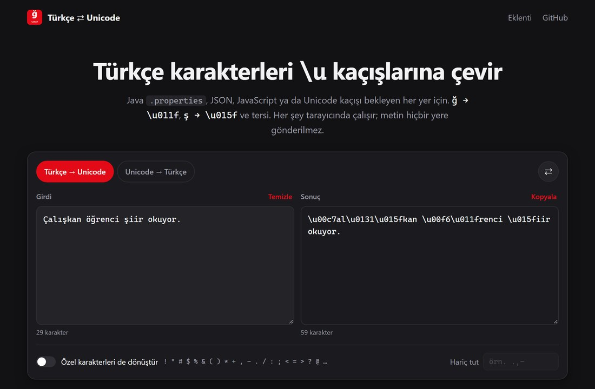

<p align="center">
  <a href="https://ardasdasdas.github.io/turkish-unicode-converter/">
    <picture>
      <source media="(prefers-color-scheme: dark)" srcset="assets/wordmark-dark.svg">
      
    </picture>
  </a>
</p>

<p align="center">
  <strong>Türkçe karakterleri <code>\uXXXX</code> Unicode kaçışlarına çevir — ve geri al.</strong>
</p>

<p align="center">
  <a href="https://ardasdasdas.github.io/turkish-unicode-converter/"></a>
  <a href="https://github.com/ardasdasdas/turkish-unicode-converter/archive/refs/heads/main.zip"></a>
  <a href="LICENSE"></a>
</p>

<p align="center">
  
</p>

---

Java `.properties` dosyaları, JSON, JavaScript ya da Unicode kaçışı bekleyen her yer için:
metni yapıştır, `ğ → \u011f`, `ş → \u015f`, `İ → \u0130` dönüşümünü anında al.
Ters yönde de çalışır: `\u00c7al\u0131\u015fkan` → `Çalışkan`. Hem web sitesi hem de Chrome
eklentisi olarak kullanılabilir.

## Özellikler

- **İki yönlü** — Türkçe → Unicode ve Unicode → Türkçe; ⇄ ile sonucu girdiye taşıyıp yönü değiştir.
- **Özel karakterler** — istersen `! " # $ % & ( ) * + , - . / : ; < = > ? @ …` karakterlerini de dönüştür.
- **Hariç tutma** — dönüştürülmesini istemediğin karakterleri ayrıca belirt.
- **Tek tıkla kopyala** — sonucu ya da hızlı tablodaki tek bir kaçışı panoya al.
- **Gizlilik** — her şey tarayıcında çalışır; eklenti hiçbir izin istemez, sayfalara script eklemez.
- **İki kullanım şekli** — web sitesi (GitHub Pages) veya Chrome eklentisi.

## Online kullan

**→ [ardasdasdas.github.io/turkish-unicode-converter](https://ardasdasdas.github.io/turkish-unicode-converter/)**

Kurulum gerektirmez. Yazdıkça çevirir, metin hiçbir sunucuya gönderilmez.

## Chrome eklentisi

Aynı çevirici, araç çubuğunda tek tıkla. İzin istemez, sayfalara script eklemez.

1. [ZIP olarak indir](https://github.com/ardasdasdas/turkish-unicode-converter/archive/refs/heads/main.zip) ve klasöre çıkar.
2. `chrome://extensions` sayfasını aç, **Geliştirici modu**nu etkinleştir.
3. **Paketlenmemiş öğe yükle** de ve `extension/` klasörünü seç.

## Örnek

| Girdi | Mod | Çıktı |
|---|---|---|
| `Çalışkan öğrenci` | Türkçe → Unicode | `\u00c7al\u0131\u015fkan \u00f6\u011frenci` |
| `Merhaba, dünya!` | + özel karakterler | `Merhaba\u002c d\u00fcnya\u0021` |
| `\u015eeker \u0131\u011fd\u0131r` | Unicode → Türkçe | `Şeker ığdır` |

## Karakter tablosu

| ğ | Ğ | ı | İ | ö | Ö | ü | Ü | ş | Ş | ç | Ç |
|---|---|---|---|---|---|---|---|---|---|---|---|
| `\u011f` | `\u011e` | `\u0131` | `\u0130` | `\u00f6` | `\u00d6` | `\u00fc` | `\u00dc` | `\u015f` | `\u015e` | `\u00e7` | `\u00c7` |

## Proje yapısı

```
extension/       Chrome eklentisi (Manifest V3)
  converter.js   Dönüştürme çekirdeği — eklenti ve web sitesi ortak kullanır
  popup.*        Eklenti arayüzü
index.html       Web sitesi (GitHub Pages)
assets/          Logo, site.css, site.js
tools/           Logo/ikon üretme betiği
```

## Lisans

[MIT](LICENSE) © 2026 Arda Uslu
